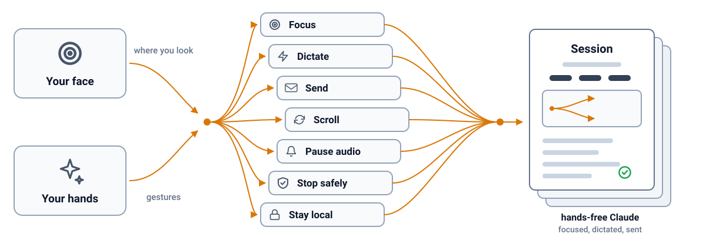

<h1 align="center">🎻 Ensemble</h1>

<b>Drives Claude's Code sessions from across the room with only a webcam.</b>

Works with 

## Features

Ensemble is a macOS menu bar app that lets you run Claude desktop's Code sessions without touching the keyboard or the mouse.

<b>Focus follows your nose</b> Look at a session and it takes focus, so every gesture lands where you are looking.

<b>Dictate and send hands-free</b> A double thumb-index pinch starts and stops Claude's own dictation, and a held thumbs-up sends the draft.

<b>Scroll with one hand</b> Pinch and drag to scroll the session, and flick for momentum.

<b>Always say what it sees</b> A capsule at the top of the screen names the state and the session, so nothing happens by surprise.

<b>Quiet while you talk</b> Other audio on your speakers fades out and pauses while you dictate, then comes back.

<b>A five-step tour on first launch</b> It shows each gesture on a 3D hand, lets you practise them without anything reaching Claude, and replays from the menu bar panel, the panel under Option-Command-K, or Settings.

<b>Private stays private</b> Camera frames are analysed in memory and never stored or sent anywhere.

## Fit

Use it when:

- You run several Claude Code sessions and want to pick one by looking at it.
- Your hands are busy or tired and you still want to dictate a prompt and send it.
- You sit far enough from the keyboard that reaching for it breaks your flow.

Look elsewhere when:

- You want voice or pointer control of every app, not only Claude.
- You use an Intel Mac or a macOS older than 14.2.
- You use Claude in a browser, since Ensemble drives the desktop app only.

It needs an Apple Silicon Mac with macOS 14.2 or later, a webcam that sees your face and your hands, and Claude desktop with Code sessions, so Intel is untested and a covered camera pauses every gesture. To install, download the app as a disk image from the [latest release](https://github.com/oficiallyAkshay/ensemble/releases/latest), drag Ensemble to Applications and open it, then choose Open Anyway in System Settings under Privacy and Security because the app is not notarized yet, then follow the five-step tour that opens on first launch: it asks for Camera, calibrates each screen and asks for Accessibility (skip it any time, and replay it from the menu bar panel's Replay tour). Ensemble remembers a calibration for each camera and screen, so changing your desk asks only for what is new: a restored setup shows a short notice, a new screen asks to calibrate just that screen (about 11 seconds) while your other screens keep working, and a new camera asks for a full calibration before looking and dictation resume. Answer with the button or a held thumbs-up, or choose Later to keep working without it.

## How it compares

| | [oficiallyAkshay/ensemble](https://github.com/oficiallyAkshay/ensemble) | [FlorianRiquelme/sleight](https://github.com/FlorianRiquelme/sleight) | [google/project-gameface](https://github.com/google/project-gameface) | [Apple head pointer and Voice Control](https://support.apple.com/guide/mac-help/use-head-pointer-mchlb2d4782b/mac) |
|---|---|---|---|---|
| Platform | macOS | macOS | Windows, Android | macOS |
| Input | Face, hands | Hands | Head, face | Head, voice |
| Built for | Claude sessions | Shortcuts | Games | Desktop |
| Install | Disk image | Source | Zip | Built in |

## Security and limits

No credential. Everything runs on your Mac, and Claude's own dictation does the listening, so Ensemble asks for Camera and Accessibility, and for the microphone only if you turn on the optional live sound bars, which also let Ensemble hold a session switch back while you are speaking.

- Never stores or sends a camera frame.
- Never records what you dictate or what is on your screen: it presses Claude's buttons and logs events and numbers only.
- Never reaches the internet from the face tracker page: every web address is blocked.
- Never updates itself unless you turn on the optional updater, which stays off until the maintainer configures a signing key.
- Never sends telemetry, analytics or crash reports.
- Never acts on another app: with anything else in front, gestures do nothing. The one exception is the audio pause, which presses the system play/pause key while you dictate, and can be turned off.

**Headphone presses.** With Bluetooth headphones as the output, one press on the stem starts dictation in the session you are looking at and one more press stops it, and two presses send, under the same rules as the thumbs-up. macOS gives apps no "headphone tapped" event, so Ensemble listens the way a music player does: it registers for media remote commands and tells macOS it is the Now Playing app, which routes a single press (play/pause) and a double press (next track) to it. It plays no sound, uses no microphone and asks for no extra permission. It holds Now Playing only while the output is Bluetooth, Claude is running and nothing else is playing audio, so while music plays your presses control the music, and Ensemble takes over again when it stops. Turn it off under Settings, Gestures, Headphone presses.

By default a thumbs-up sends only within 30 seconds of your dictation ending, only into the session you dictated into, and only if you have not typed or clicked since. Gesture send can be turned off in Settings, and so can the audio pause. A Claude update that renames its controls can break Ensemble until it is updated, pointing is as precise as a head pose and picks a session, not a line of text, and a second face in view pauses every gesture.
