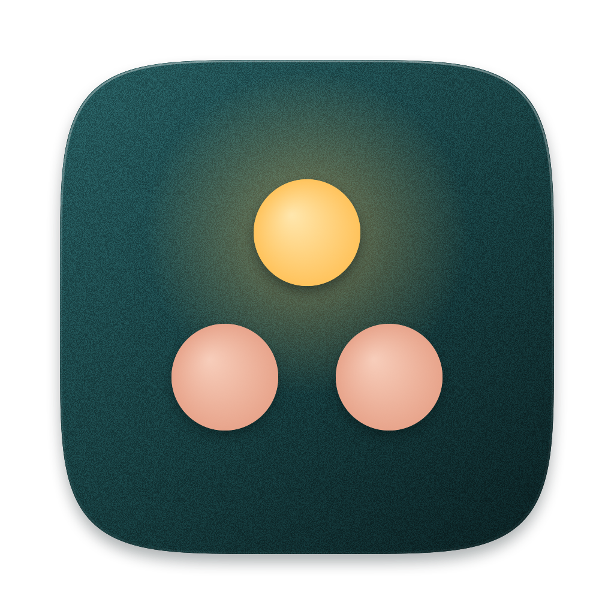

<!-- TODO(owner): LICENSE says "Clutch contributors"; put your legal name or organisation there before the first release. -->
<!-- TODO(owner): replace OWNER/REPO in the links below once the repository exists. -->
<p align="center"></p>

# Clutch

**Drive Claude desktop's Code sessions from across the room: look at a session to focus it, pinch twice to dictate, hold a thumbs-up to send, pinch and drag to scroll. A webcam and your hands, nothing else.**

<!-- TODO(owner): record a 10-15 second GIF (look at a session, double pinch, speak, thumbs-up) and put it at docs/demo.gif, then replace this line with:  -->
> Demo GIF coming: a session lights up as you look at it, two pinches start dictation, a thumbs-up sends the draft.

Clutch is a macOS menu-bar app. A hidden MediaPipe face tracker works out which Claude session you are facing, Apple's Vision framework reads your hand pose, and an Accessibility bridge presses Claude's own controls (its dictation button, its Send button, its scroll area). Clutch does no speech recognition of its own: Claude's dictation does the listening. Everything runs on your Mac.

## What it does

- **Focus by looking.** Your nose is the pointer. After a short calibration, the Claude session you face is highlighted and is the target of every gesture.
- **Hands-free dictation.** A double thumb-to-index pinch starts Claude's dictation; a second double pinch stops it. Your hand can leave the frame in between.
- **Send by gesture.** Hold a thumbs-up and the dictated draft is sent.
- **Scroll by gesture.** Pinch and drag up or down to scroll the session, at your system's scroll direction and speed.
- **A status capsule** at the top of the screen (a floating one on screens without a notch) shows what Clutch sees and what it is about to do, so nothing happens by surprise.

## Gestures

| Do this | What happens |
|---|---|
| Look at a Claude session | That session is the target. Looking at a different session while listening pauses dictation after 2 seconds |
| Pinch thumb and index twice, quickly | Start listening (Claude's dictation). Do it again to stop |
| Hold a thumbs-up (0.75 s by default, 0.5 to 3 s in Settings) | Send the dictated draft. Works only within 30 seconds of dictation ending |
| Pinch and drag up or down | Scroll the session |

Gestures can be remapped in Settings, including turning the thumbs-up send off. `Option-Command-K` opens the control panel from anywhere.

## Requirements

- macOS 14.2 or later (the dictation safety check reads which apps are using the microphone, an API introduced in 14.2). Developed and tested on macOS 26.
- Apple Silicon. Built and tested only on an Apple Silicon Mac; Intel has not been tried.
- A webcam (the built-in one works; place it so it sees your face and your hands).
- [Claude desktop](https://claude.com/download) with Code sessions.

## Install

1. Download the latest DMG from [Releases](https://github.com/OWNER/REPO/releases/latest).
2. Drag the app to Applications and open it. A hand icon appears in the menu bar.
3. Grant Camera and Accessibility when asked, then choose Calibrate from the menu-bar panel.

Homebrew cask: planned, not available yet.
<!-- TODO(owner): note here whether releases are notarized; if not, add the right-click > Open step for Gatekeeper. -->

## Permissions

| Permission | Why |
|---|---|
| Camera | Reads your head direction and hand pose. Frames are analysed in memory and discarded |
| Accessibility | Finds Claude's session panes and presses its dictation, Send and scroll controls |
| Notifications (optional) | Alerts and sound cues when a safety check refuses or stops something |

Clutch does not ask for the Microphone permission: Claude records, and Clutch only watches which apps are recording.

## Privacy

- Video is analysed on your Mac. Frames are never written to disk and never sent anywhere.
- The app makes no network connections. The face tracker is a web page served from inside the app bundle through a custom URL scheme, and the model ships in the bundle.
- It only acts on Claude. If another app is in front, gestures do nothing.
- The only files it writes are settings, a small log, and the two safety records described below. The log is rolled over at 1 MB (one backup, `clutch.log.1`), so it stays under about 2 MB; per-frame hand-tuning lines are written only when the hidden setting `verboseLog` is on (`defaults write dev.clutch.app verboseLog -bool true`, then restart).

## Safety design

Dictation controls a microphone, so the rule is: Claude's microphone is never left recording because of Clutch.

- **Written before pressed.** A record of "dictation started" is saved and flushed to disk before the microphone button is pressed. If the app crashes mid-recording, the next launch finds the record and stops it.
- **Dead-man check.** While listening, the app must keep confirming it is alive roughly every second, or dictation is stopped.
- **Standing check.** A timer verifies, even when nothing seems wrong, that Claude's microphone state matches what Clutch believes.
- **Fallback.** If a stop cannot be confirmed, Clutch sounds an alarm and mutes the input device Claude is using, recording the change so it can be undone later.
- **Quitting stops dictation** before the process exits.
- **Dictation stops and gestures are refused** when you type or click, when more than one face is in view, when no face has been seen for 10 seconds, when the camera is covered, when another app starts using a microphone, or when the input device changes.
- **Send is narrow.** It needs a non-empty draft, dictation that ended in the last 30 seconds, and no keyboard or mouse use since.

## Build from source

```
swift build            # debug build
swift test             # unit tests (see below)
scripts/bundle.sh      # release build -> build/Clutch.app, code-signed
```

The tests use Swift Testing. With only the Command Line Tools installed, add the framework paths:

```
F=/Library/Developer/CommandLineTools/Library/Developer/Frameworks
L=/Library/Developer/CommandLineTools/Library/Developer/usr/lib
swift test --enable-swift-testing -Xswiftc -F -Xswiftc $F -Xlinker -F -Xlinker $F -Xlinker -rpath -Xlinker $F -Xlinker -rpath -Xlinker $L
```

**Signing identity.** `scripts/bundle.sh` signs with a local code-signing certificate named `Clutch Local Signing` (override with `CLUTCH_SIGN_IDENTITY`) and stops with an error if it is missing. It never signs ad hoc: an ad-hoc signature is a new identity on every build, and macOS then asks for Camera and Accessibility again each time. Create the certificate once in Keychain Access > Certificate Assistant > Create a Certificate (type: Code Signing). `swift scripts/make-icon.swift` redraws the app icon.

## Architecture

- **`Sources/ClutchCore`** is pure logic with no UI or camera access, and is fully unit-tested: the gesture state machine, the nose pointer (calibration fit plus a One Euro filter), the covered-camera and multi-face detectors, the size-capped log file, and the hand-pose classifier adapted from Sleight (`Vendor/`).
- **`Sources/Clutch`** is the app:
  - `Engine/` captures camera frames. Hands go to Apple's Vision hand-pose request. Faces go to MediaPipe Face Landmarker running in a hidden `WKWebView` (the MediaPipe runtime, its WebAssembly and the model are bundled in `Resources/web` and served by a custom URL scheme, so nothing touches the network).
  - `Claude/` is the Accessibility bridge: it finds Claude's session panes, reads the state of the dictation, Send and mode controls, presses them, and runs the dictation safety checks.
  - `Coordinator/` joins the two: it turns gesture intents into actions on the session you are looking at, after every safety guard has agreed.
  - `App/` is the shell: menu bar, settings, calibration, the status capsule and overlay, hotkey, notifications.

## Limitations

- The Claude bridge reads Claude desktop's interface through Accessibility by the labels it shows today. A Claude update that renames or restructures those controls can break it until Clutch is updated.
- Pointing accuracy is that of a head pose, not an eye tracker: it picks a session pane, not a line of text. Recalibrate when you move your seat or change monitors.
- Gestures need decent light and a camera that sees your hand. Glasses, hats and strong backlight reduce face tracking quality.
- One person in view at a time: a second face pauses all gestures by design.
- Sending by gesture is not restricted by Claude's permission mode. Turn gesture send off in Settings if you want to press Send yourself.
- The Homebrew cask and automatic updates do not exist yet.

## Roadmap

- Record and publish the demo GIF; signed and notarized DMG; Homebrew cask.
- Automatic updates.
- Restrict gesture send to Claude's confirm-before-run permission modes.
- Intel and older-macOS testing.
- Rename to Leanback.

## Contributing

Issues and pull requests are welcome. Before opening a pull request, run `swift build` and the tests above; changes to `ClutchCore` should come with a test, since its gesture timing is replayed deterministically from recorded fixtures. Anything that touches dictation or sending must keep the safety rules above intact: say in the pull request how the change preserves them.

## Credits and licenses

Clutch is MIT licensed (see [LICENSE](LICENSE)). It includes:

- [MediaPipe](https://github.com/google-ai-edge/mediapipe) by Google, Apache-2.0, plus the Face Landmarker model.
- Sleight by Florian Riquelme, MIT. The hand-pose rules in `Sources/ClutchCore/Vendor/Sleight`.
- claude-dictation-hotkey by Rene Banuelos, MIT. The approach to driving Claude's dictation.

Full notices, including the model licensing note, are in [THIRD_PARTY_NOTICES.md](THIRD_PARTY_NOTICES.md). Clutch is an independent project and is not affiliated with or endorsed by Anthropic.

## Releases and updates

Releases are DMGs on GitHub Releases, built by `scripts/release.sh` (signed with a Developer ID and notarized
when those credentials are configured). In-app updates use [Sparkle](https://sparkle-project.org) and stay off
until the update feed and signing key are configured. Maintainer steps: [docs/RELEASING.md](docs/RELEASING.md).
